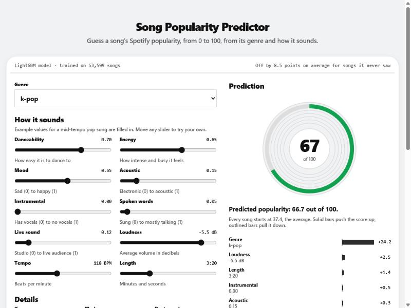
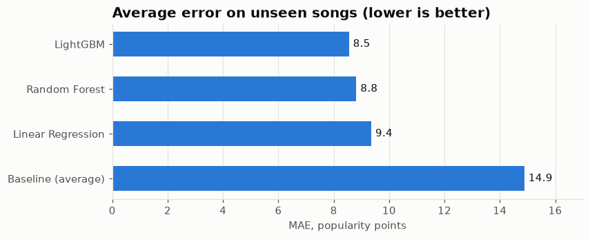
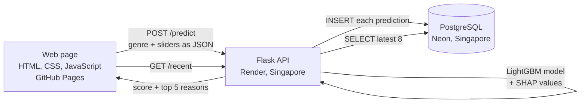
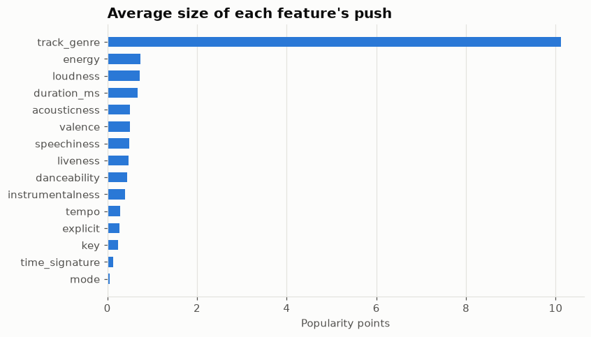
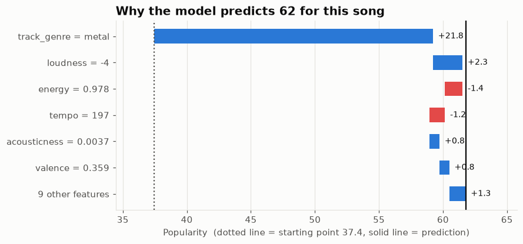
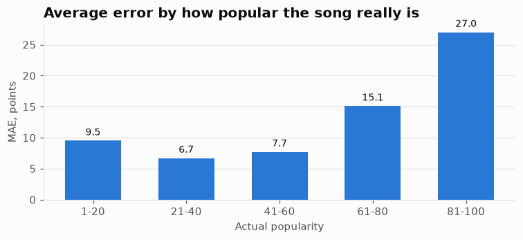

# Song Popularity Predictor

[](https://github.com/katts-69/song-popularity-predictor/actions/workflows/tests.yml)
[](https://katts-69.github.io/song-popularity-predictor/)

**[Try the live demo](https://katts-69.github.io/song-popularity-predictor/)**

Pick a genre, move the sliders that describe how a song sounds, and the app predicts the song's Spotify popularity from 0 to 100. It also shows the five features that pushed the score up or down the most. Every prediction is saved to a PostgreSQL database and listed on the page.

The model is LightGBM, trained on 53,599 Spotify songs. On 11,485 songs it never saw, its guesses are off by **8.45 points** on average, against 14.85 points for always guessing the average.



> The free server sleeps when nobody uses it. The first prediction after a quiet spell can take up to a minute while it wakes up; the page shows a counter while you wait.

## Highlights

- **Cleaned the data in SQL.** The 114,000-row Kaggle file holds only 89,741 different songs, because songs are listed once per genre (one song appears under 9 genres). I removed the copies so the same song can't land in both the training and test sets, which would have made the scores look better than they are.
- **Found where the labels mislead the model.** 19 of the model's 20 worst errors are songs it rated around 60 to 75 that the data lists at 1 to 9. The ones I looked up, such as Coldplay's *Yellow*, appear in the dataset only on compilation albums, and Spotify scores each release separately, so those copies score 1 to 4.
- **Compared four models against a baseline,** and used the locked test set only once, for the final score.
- **Explained every prediction with SHAP,** and corrected an early conclusion when SHAP showed it was confounded by genre.
- **Built it test-first:** 114 tests, each written before the code and shown failing first. I planted bugs on purpose to check the tests catch them.
- **Deployed three parts that talk to each other:** a static page on GitHub Pages, a Flask API on Render, and a PostgreSQL database on Neon.

## Contents

1. [Results](#results)
2. [How it works](#how-it-works)
3. [The data](#the-data)
4. [What the model learned](#what-the-model-learned)
5. [Testing](#testing)
6. [Security](#security)
7. [Limitations](#limitations)
8. [Run it yourself](#run-it-yourself)
9. [Project structure](#project-structure)

## Results

**Final score on the locked test songs** (11,485 songs, used once):

| Model | MAE | RMSE | R² |
|---|---|---|---|
| Always guess the average | 14.85 | 17.85 | 0.00 |
| **LightGBM** | **8.45** | **12.17** | **0.535** |

**Choosing the model** (validation songs, 11,485):

| Model | MAE | RMSE | R² |
|---|---|---|---|
| Always guess the average | 14.88 | 17.80 | 0.00 |
| Linear Regression | 9.35 | 12.80 | 0.483 |
| Random Forest | 8.81 | 12.35 | 0.518 |
| LightGBM | 8.55 | 12.23 | 0.528 |

MAE is how many points a guess is off on average. RMSE counts big misses more heavily. R² is the share of the variation in popularity the model explains.



Every model beats the baseline by 5.5 to 6.3 points, and LightGBM beats a straight line by only 0.8. Most of what this data can predict comes from genre, which even Linear Regression handles well; the trees add the curved effects of the audio features. Random Forest memorised its training songs (MAE 4.51 on them against 8.81 on new songs), while LightGBM overfit less and scored best on unseen songs.

## How it works



1. The page sends the song's genre and audio features to the API as JSON with `fetch()`.
2. The API checks every value (ranges, types, known genre), predicts with the saved LightGBM model, and splits the prediction into one push per feature with SHAP.
3. It saves the prediction to PostgreSQL and returns the score and the five biggest pushes.
4. The page draws the score as a disc and the pushes as a bar chart, and reloads the list of recent predictions.

The API and the database run in the same region (Singapore) so each save is a short trip. The API only accepts calls from the GitHub Pages site (CORS).

## The data

[Spotify Tracks Dataset](https://www.kaggle.com/datasets/maharshipandya/-spotify-tracks-dataset) on Kaggle: 114,000 rows, 114 genres with 1,000 rows each (the Kaggle page says 125 genres; the file has 114). Each row has a popularity score from 0 to 100 and audio features measured by Spotify, such as energy, danceability, tempo and loudness. The data isn't in this repository; [Run it yourself](#run-it-yourself) explains how to get it.

I loaded the CSV into SQLite and explored and cleaned it with SQL ([notebooks/01_sql_exploration.ipynb](notebooks/01_sql_exploration.ipynb), [src/db.py](src/db.py)):

| Problem found | Decision |
|---|---|
| Same song ID listed under several genres (up to 9) | Keep one row per song, with one of its genres picked at random (seeded, so it's repeatable) and its popularity averaged across copies. Picking the first copy would have favoured genres early in the alphabet. |
| Same song and artist under different IDs (4,657 songs, often an album version plus compilation copies) | Keep only the most popular release |
| Popularity 0 (16,020 rows) | Treated as "no score", not "nobody listens": the zeros cluster in a few genres (65% of iranian songs, 61% of romance), which points to how the data was collected. Dropped after the steps above. |
| 1 row with no song name or artist | Dropped |

Result: **76,569 songs**, one row each, split 70 / 15 / 15 into train, validation and test, keeping each genre's share the same in all three.

## What the model learned

**Genre matters more than ten times as much as anything else.** On a typical song, genre pushes the prediction by about 10 points; the next biggest features, energy and loudness, push by under 1. Genre alone explains about half of the variation in popularity.



**Each prediction can be explained.** SHAP starts every song at the average popularity (37.4) and gives each feature a push up or down; the pushes add up exactly to the prediction. The API returns these pushes and the page shows them.



**A correction.** Looking at energy on its own ([notebooks/02_eda.ipynb](notebooks/02_eda.ipynb)), popularity seemed to rise with energy and then fall. SHAP, which measures energy after genre has been accounted for, shows only the fall for the most intense songs. Quiet songs looked unpopular because they mostly come from less popular genres (confounding).

**The model plays it safe with hits.** On the validation songs it is off by about 7 points for typical songs but 27 points for songs above 80, and it never predicts above 84. Hits depend on things this data doesn't have, such as the artist's fame, so the model pulls its guesses toward the middle.



## Testing

- **114 tests**, run with `pytest`. GitHub Actions runs them on every push; there, 105 run and 9 are skipped because they need the real dataset or the database password.
- **Written first.** Each test was written from the requirement before the code existed, and shown failing before the code made it pass.
- **Checked with planted bugs.** After each feature I broke the code on purpose (for example, keeping the alphabetically first genre, or saving the wrong genre) and confirmed a test failed. One planted bug went uncaught; the investigation showed LightGBM already handled that case, so the code behaved identically.
- **Coverage review.** Line coverage was 88%. Planting bugs in the untested lines showed seven real gaps, mostly how the live server reads its settings; after new tests, coverage is 95% locally and every planted bug is caught.
- **Real database tests** write to a throwaway table with a random name and delete it afterwards, so the live log is never touched.

## Security

- **Rate limit:** 10 predictions per minute per visitor. CORS only stops browsers on other websites, not scripts, so the limit is what protects the database from being flooded.
- **Size cap:** requests over 16 KB are refused before they're read (a song is under 1 KB).
- **Input checks:** every feature is checked for type and range; NaN, Infinity and unknown genres get a clear 400 error.
- **SQL injection:** values are sent to PostgreSQL as parameters, separately from the SQL text.
- **Secrets:** the database URL lives only in a local `.env` file (ignored by Git) and in Render's settings.
- **Audits:** `pip-audit` finds no known vulnerabilities in the pinned libraries, and no secret appears anywhere in the Git history.

## Limitations

- **About half of popularity isn't in this data.** R² of 0.535 means artist fame, marketing, playlists and timing, none of which are features, explain much of the rest.
- **Noisy labels.** Some songs only appear as low-scoring compilation releases, so their popularity is far lower than the song's real reach.
- **Not a hit detector.** Errors are largest for the most popular songs.
- **Random genre for multi-genre songs.** A song filed under 9 genres keeps one of them at random, so some labels are odd (Badfinger's *Baby Blue* ended up as j-pop).
- **Slider input only.** Spotify closed its audio-features API to new apps in November 2024, so the app can't look up a real song by link; you describe the song with sliders instead.
- **Free hosting.** The API sleeps after a quiet spell and takes up to a minute to wake.

## Run it yourself

You need Python 3.11 and a free Kaggle account.

```bash
git clone https://github.com/katts-69/song-popularity-predictor.git
cd song-popularity-predictor
python -m venv .venv
```

Activate the environment (`.venv\Scripts\activate` on Windows, `source .venv/bin/activate` on macOS and Linux), then:

```bash
pip install -r requirements.txt
```

Download the [Spotify Tracks Dataset](https://www.kaggle.com/datasets/maharshipandya/-spotify-tracks-dataset) and save `dataset.csv` as `data/raw/dataset.csv`. Then:

```bash
python -m src.db        # load the CSV into data/spotify.db and build the clean table
python -m src.train     # train LightGBM, save models/model.joblib and models/metrics.json
pytest                  # run the tests
```

To run the app locally, create a `.env` file in the project folder:

```
ALLOWED_ORIGINS=http://localhost:8000
# Optional: a PostgreSQL connection string to save predictions
# DATABASE_URL=postgresql://...
```

Then start the API and the page in two terminals and open http://localhost:8000:

```bash
flask --app api.wsgi run
python -m http.server 8000 --directory web
```

Without `DATABASE_URL` the app still predicts; it just doesn't save or list recent predictions. To create the table in your own database, run [api/schema.sql](api/schema.sql).

## Project structure

```
song-popularity-predictor/
├── notebooks/
│   ├── 01_sql_exploration.ipynb   exploring and cleaning with SQL
│   ├── 02_eda.ipynb               charts and first findings
│   ├── 03_models.ipynb            baseline and three models, final test score
│   └── 04_explain.ipynb           SHAP and the worst predictions
├── src/
│   ├── db.py                      CSV to SQLite, cleaning rules in SQL
│   ├── data.py                    feature list and the train/validation/test split
│   ├── train.py                   trains and saves the model
│   └── predict.py                 scores and explains one song
├── api/
│   ├── app.py                     Flask API: /health, /genres, /predict, /recent
│   ├── store.py                   saving to PostgreSQL
│   ├── schema.sql                 the predictions table
│   └── wsgi.py                    entry point for the server
├── web/                           the page: index.html, style.css, app.js, config.js
├── models/                        model.joblib (3.4 MB) and metrics.json
├── tests/                         114 tests
├── docs/                          images for this README
├── DESIGN.md                      the page's visual design
├── render.yaml                    how Render runs the API
├── requirements.txt               libraries for the notebooks and tests
└── requirements-api.txt           the smaller list the server installs
```

## Credits

Data: [Spotify Tracks Dataset](https://www.kaggle.com/datasets/maharshipandya/-spotify-tracks-dataset) by Maharshi Pandya on Kaggle; see the dataset page for its licence. Popularity scores and audio features come from Spotify.
